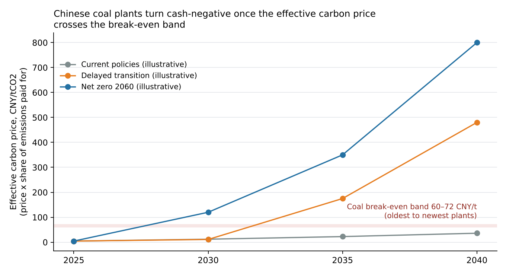
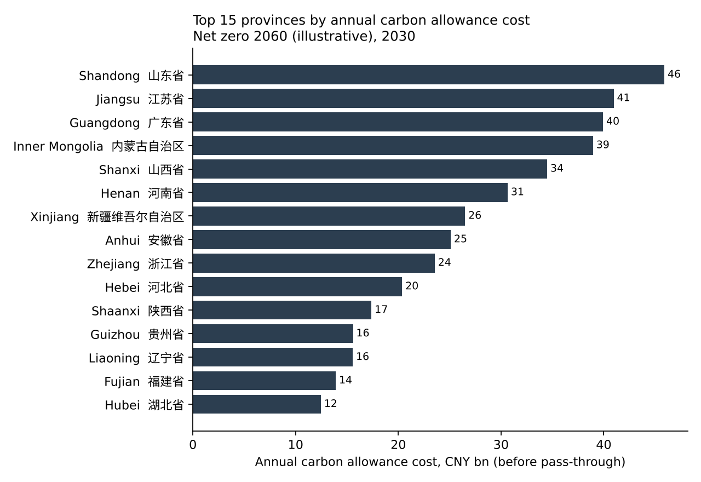
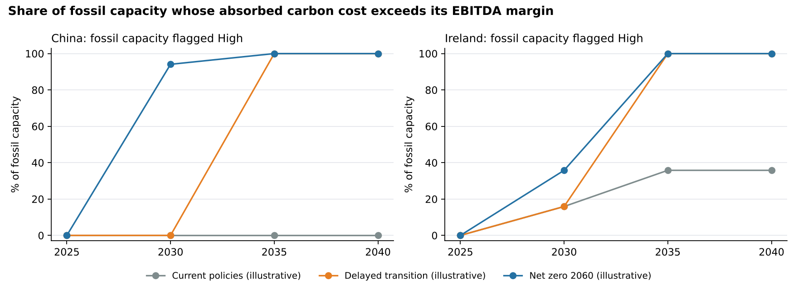

# China power-sector transition-risk screener

**Which Chinese coal and gas plants, provinces and owners are most exposed if carbon costs rise, and at what carbon price does a plant stop covering its costs?**

An open-source Python model that stress-tests 1,121 Chinese fossil power plants (about 1,017 GW) under carbon-price scenarios. It flags the plants whose absorbed carbon cost would wipe out their operating margin, and rolls the results up by province and owner, the way a lender's risk team would review a power-sector book. Ireland's 17 fossil plants run through the same model as a contrast case.

> **Status:** v0.1. The scenario carbon prices are **illustrative placeholders**, so the results show how the model behaves, not a forecast. See [Limitations](#limitations) before quoting any number.



## Key findings (illustrative scenarios)

1. **The fleet has a narrow break-even band.** A coal plant's absorbed carbon cost exceeds its assumed 15% EBITDA margin once the *effective* carbon price (headline price × share of emissions actually paid for) reaches **60–72 CNY/tCO2**. Older, less efficient plants hit it first. Gas breaks even at about **153 CNY/t**.
2. **Free allocation, not the headline price, is the swing factor.** China's ETS gives power plants benchmark-based free allowances. While only 5–10% of emissions are paid for, even a 120 CNY/t price stays below break-even. In the illustrative net-zero path, raising the paid share to 40% by 2030 pushes **94% of fossil capacity** past break-even.
3. **Exposure is concentrated.** Under that scenario in 2030, Shandong, Jiangsu, Guangdong, Inner Mongolia and Shanxi carry **39%** of the fleet's CNY 515 bn annual allowance cost. China Huaneng, China Guodian and Huadian Power International are the most exposed named owners.
4. **Pass-through changes the picture.** Ireland's plants pay for every tonne, but in a marginal-price market most of that cost reaches the wholesale price. With 80% pass-through, only Ireland's coal and oil units are flagged before 2035.

| Province | 省份 | Fossil capacity (GW) | Emissions (MtCO2/yr) | Allowance cost, 2030 (CNY bn) | Capacity flagged High |
|---|---|---:|---:|---:|---:|
| Shandong | 山东省 | 86.1 | 382 | 45.9 | 100% |
| Jiangsu | 江苏省 | 82.4 | 341 | 41.0 | 92% |
| Guangdong | 广东省 | 87.7 | 333 | 39.9 | 81% |
| Inner Mongolia | 内蒙古自治区 | 73.9 | 325 | 39.0 | 99% |
| Shanxi | 山西省 | 64.8 | 287 | 34.5 | 99% |

*Net zero 2060 (illustrative) scenario, 2030. Full tables in [`outputs/`](outputs/).*




## How it works

```
GPPD plants ──► assign province (spatial join) ──► estimate CO2 per plant ──► carbon-cost stress ──► flags, roll-ups, charts
                Natural Earth admin-1              IPCC fuel factors /         scenario × year
                                                   efficiency by vintage
```

| Step | What it does |
|---|---|
| **1. Load** | Chinese and Irish plants from the WRI Global Power Plant Database: location, fuel, capacity, owner, commissioning year, estimated 2017 generation. |
| **2. Locate** | Spatially joins each plant to a province (China) or county (Ireland) using Natural Earth boundaries; coastal plants snap to the nearest area within 25 km. All 4,294 plants were assigned. |
| **3. Emissions** | tCO2/MWh = IPCC 2006 default fuel CO2 factor × 3.6 GJ/MWh ÷ plant efficiency. Coal efficiency is banded by commissioning year (33% pre-2000, 37% 2000s, 40% 2010+). |
| **4. Stress** | For each scenario and year: carbon cost = emissions × price × paid share; absorbed cost = carbon cost × (1 − pass-through); compared with revenue (generation × tariff) and a baseline EBITDA margin. |
| **5. Flag** | **High** = absorbed carbon cost ≥ EBITDA margin (plant goes cash-negative); **Watch** = ≥ 50% of margin; **Low** otherwise. Also reports each plant's break-even effective carbon price. |

Every assumption is in one file, [`config/assumptions.yaml`](config/assumptions.yaml), and is labelled ASSUMPTION or ILLUSTRATIVE.

## Run it

```bash
pip install -e ".[dev]"
python -m transition_risk --download     # fetches the data, runs everything, writes outputs/
pytest                                    # unit tests for the emission and stress maths
```

Outputs: `plant_watchlist_top50.csv`, `province_exposure.csv`, `owner_exposure.csv`, `breakeven_by_vintage.csv`, `scenario_paths.csv`, `fleet_summary.csv` and the figures in `outputs/figures/`. CSVs with Chinese province names are UTF-8 with BOM so they open cleanly in Excel.

## Limitations

- **Illustrative scenarios.** The carbon-price and free-allocation paths are placeholders. Before using results, replace them with sourced paths (for example NGFS Phase V scenario carbon prices) and record the source in the config.
- **Data vintage.** WRI stopped maintaining the Global Power Plant Database after v1.3.0. Plants built, retired or converted since then are not reflected, and the database covers about 956 GW of Chinese coal, not the whole fleet.
- **Modelled generation.** GPPD's 2017 generation for Chinese coal plants is an estimate from a uniform capacity factor, not reported output. You can override it per fuel in the config.
- **Uniform economics.** One national tariff, margin and pass-through rate per country. In reality these vary by province, contract and plant, so plant-level flags differ only by fuel and vintage; absolute exposure differs by size.
- **Scope.** Direct CO2 from combustion only: no methane, no coal-price feedback, no capacity payments, and no CCUS or retrofit options.

## Data and licences

| Dataset | Use | Licence |
|---|---|---|
| [WRI Global Power Plant Database v1.3.0](https://github.com/wri/global-power-plant-database) | Plant location, fuel, capacity, owner, generation estimates | CC BY 4.0 |
| [Natural Earth 1:10m admin-1](https://github.com/nvkelso/natural-earth-vector) | Province and county boundaries for the spatial join | Public domain |
| IPCC 2006 Guidelines for National GHG Inventories, Vol. 2, Ch. 2, Table 2.2 | Default fuel CO2 emission factors | Cited |

Code is MIT-licensed. Built by Michael S H Xiang (Columbia–Trinity Dual BA, Earth Sciences / Geography and Geosciences). Uses only public data; no employer data or confidential material.

## Roadmap

- [ ] Replace illustrative paths with NGFS Phase V carbon prices
- [ ] Province-level tariffs and capacity factors
- [ ] Sensitivity table: break-even vs margin and pass-through
- [ ] Map output using an approved basemap
